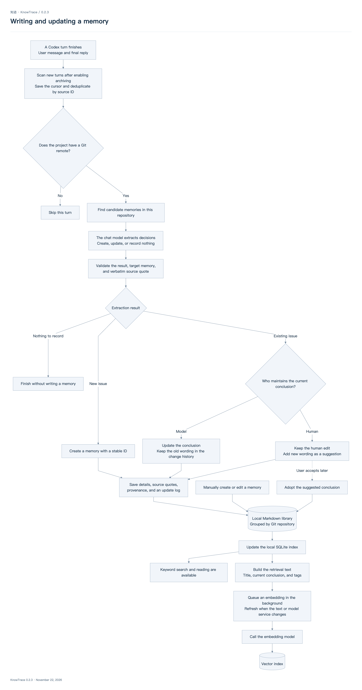
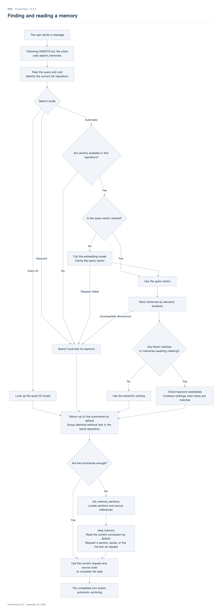

# KnowTrace · 知迹

[简体中文](README.md) · **English**

KnowTrace is a desktop app for macOS and Windows that helps you find the decisions behind your code. It saves decisions from Codex conversations as local Markdown files, grouped by Git repository, alongside the words that support them. In a fresh session, your coding assistant can use the Model Context Protocol (MCP) to look up both the decision and its reasoning.

**v0.2.3** is the first release under the KnowTrace name. If you are upgrading from AiMemory, your existing library, model settings, and archive progress carry over. [Release notes](https://github.com/guo-straw/AiMemory/releases/tag/v0.2.3)

The memory graph draws on Yuuyuko-uu’s visual and interaction design. KnowTrace implements the layout, repository colors, and navigation between linked memories in Vue, TypeScript, and Canvas. [dsh-xingxi](https://github.com/Yuuyuko-uu/dsh-xingxi) · [Upstream license](src/licenses/dsh-xingxi/LICENSE)

## Download v0.2.3

| Platform | Installer |
| --- | --- |
| macOS · Apple silicon (M series) | [Download the ARM64 DMG](https://github.com/guo-straw/AiMemory/releases/download/v0.2.3/KnowTrace_0.2.3_aarch64.dmg) |
| macOS · Intel | [Download the x64 DMG](https://github.com/guo-straw/AiMemory/releases/download/v0.2.3/KnowTrace_0.2.3_x64.dmg) |
| Windows · x64 | [Download the installer](https://github.com/guo-straw/AiMemory/releases/download/v0.2.3/KnowTrace_0.2.3_x64-setup.exe) |

The macOS builds use ad hoc signing and have not been notarized by Apple. The Windows installer is unsigned.

## Find the reasoning behind a change

In the sample project, ask “Why did we switch export progress to polling?” The saved decision explains that an older proxy buffered server-sent events. The team chose to poll every two seconds and stop when the job finished or the user left the page. Open the memory to read the original exchange. [Sample data](scripts/fixtures/graph-seed.json)

- **Keep a decision and its follow-ups together.** When automatic archiving is enabled, KnowTrace extracts decisions supported by quotes from completed Codex turns. Later work on the same issue adds evidence to the existing memory.
- **Keep your edits in effect.** When you revise a conclusion, it becomes the version shown to readers and used for retrieval. Later turns can add evidence and suggest new wording for you to accept.
- **Read a summary before opening the source.** The desktop app and MCP share a search engine. A query returns up to five summaries by default. Request a section or a quote from a single turn when you need the detail. Keywords and exact IDs work locally even when vectors are unavailable.
- **Follow a decision across repositories.** Pick a node in the memory graph to explore its links to other decisions, including those recorded in another repository.

<details>
<summary>How KnowTrace writes and updates a memory</summary>



</details>

<details>
<summary>How KnowTrace finds and reads a memory</summary>



</details>

## Get started

1. Open **Settings & Connections → Memory Library & Repositories** (设置与接入 → 记忆库与仓库). Choose a local library and add your project’s Git remote. In the workbench, select **New Memory** (新增记忆) to save your first decision.
2. To archive Codex turns automatically, configure a chat service under **Model Services** (模型服务). Under **Automatic Archiving** (自动归档), select your Codex data directory, enable archiving, and save. KnowTrace picks up turns that finish after that point. Configure an embedding service to enable semantic search.
3. To read memories from a coding assistant, open **MCP Connection** (MCP 接入), select **Start Service** (启动服务), and copy the displayed address into your assistant’s MCP settings. Select **Streamable HTTP** as the transport. The default endpoint is `http://127.0.0.1:37241/mcp`.

<details>
<summary>Query instructions to copy into your project’s AGENTS.md</summary>

```md
For each user message, first call search_memories on the KnowTrace MCP server with the current working directory (cwd) and terms relevant to the request.
Read the summaries first. For details, use list_memory_sections to locate the relevant section, then read_memory to fetch that section or its source quote.
Search again when the topic changes. Treat memories as historical context and check them against the current request and source code. Report a failed lookup.
```

</details>

## Data and model services

Manual editing, keyword search, reading, and graph navigation work offline. Automatic archiving sends the user message, final assistant reply, and summaries of candidate memories to the chat service you configure. To index a memory, the embedding service receives its title, current conclusion, and tags. Semantic search reuses cached query vectors and sends the query text only when it needs a new vector.

## Run from source

Install Node.js 24, pnpm, Rust stable, and the platform dependencies in the [Tauri 2 prerequisites](https://v2.tauri.app/start/prerequisites/). Run these commands from the repository root.

```sh
pnpm install --frozen-lockfile
pnpm desktop
```

## License

KnowTrace code is available under the [MIT License](LICENSE). The provider icons are by LobeHub and retain their [MIT license and attribution](src/assets/providers/LICENSE).
