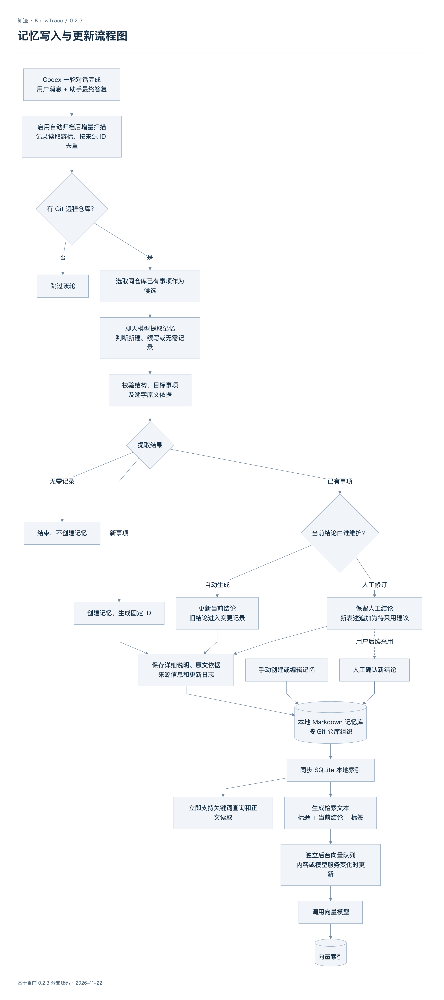
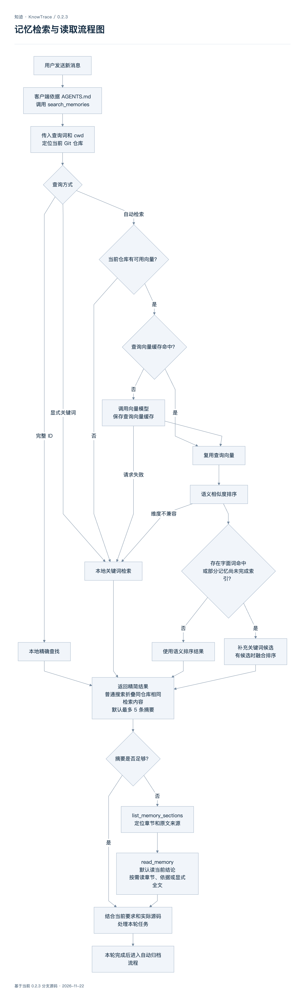

# 知迹 · KnowTrace

**简体中文** · [English](README.en.md)

知迹是一款 macOS 和 Windows 桌面应用，帮你找回代码背后的决定。它把 Codex 对话中的结论和原文依据保存为本地 Markdown，按 Git 仓库整理。换一个会话，编码助手也能通过模型上下文协议（MCP）查到这项决定，以及当时为什么这样做。

**v0.2.5** 新增 Codex 本地用量统计，支持趋势、使用日历、会话追溯和 CSV 导出，默认按 OpenAI 官方定价估算参考费用，并改进滚动体验。升级会沿用原来的记忆库、模型配置和归档进度。[查看发布说明](https://github.com/guo-straw/AiMemory/releases/tag/v0.2.5)

## 下载 v0.2.5

| 平台 | 安装包 |
| --- | --- |
| macOS · Apple 芯片（M 系列） | [下载 ARM64 DMG](https://github.com/guo-straw/AiMemory/releases/download/v0.2.5/KnowTrace_0.2.5_aarch64.dmg) |
| macOS · Intel | [下载 x64 DMG](https://github.com/guo-straw/AiMemory/releases/download/v0.2.5/KnowTrace_0.2.5_x64.dmg) |
| Windows · x64 | [下载安装程序](https://github.com/guo-straw/AiMemory/releases/download/v0.2.5/KnowTrace_0.2.5_x64-setup.exe) |

macOS 安装包使用临时签名，未经 Apple 公证。Windows 安装程序未签名。

## 从一句问题找回原决定

在示例项目里问「导出进度为什么改成轮询？」，可以查到当时的原因。旧代理会缓冲 SSE 响应，团队因此决定每两秒查询一次，任务结束或离开页面就停止。打开这条记忆，还能看到当时的原话。[查看示例数据](scripts/fixtures/graph-seed.json)

- **按事项归档。** 开启自动归档后，知迹从已完成的 Codex 对话中提取有原文依据的决定。同一事项的后续进展会写回原记忆，多轮证据可以一起查阅。
- **保留人工修订。** 你改过的结论会继续用于展示和检索。后续归档可以补充依据，新的表述由你决定是否采用。
- **先读摘要，再看依据。** 桌面端和 MCP 共用检索逻辑。查询默认返回最多五条摘要，可继续读指定章节或单轮引文。向量不可用时，仍可用本地关键词或完整 ID 查找。
- **按代码归档和关联。** 同一轮涉及多个 Git 仓库时，前端、后端的记忆分别归入对应仓库。同一 Git 仓库中的代码仍归在一起；同文件的独立修改、功能依赖和跨仓库协作可以互相关联，在详情和记忆星图中沿关联阅读。
- **管理仓库。** 右键侧栏或设置页中的仓库可重命名或删除。删除会移除关联，并将记忆文件放入记忆库的 `.aimemory/trash` 本地回收目录，不改动原始 Git 项目。后续新归档仍可重新接入该仓库。
- **平滑浏览。** 列表、正文和设置页支持连续变速的滚轮滚动，连续滚动平顺提速，停止后逐渐减速；仓库右键菜单使用浅色背景高亮。

<details>
<summary>查看记忆写入与更新流程图</summary>



</details>

<details>
<summary>查看记忆检索与读取流程图</summary>



</details>

## Codex 用量统计

在「归档与用量 → Codex 用量」查看本机 Codex 的 Token、缓存命中、每日趋势与会话、模型、项目汇总。直接扫描 Codex 目录中的 `sessions` 和 `archived_sessions`，独立于自动归档开关；会话详情可以追溯到原始日志，筛选结果可导出为 CSV。

参考费用默认采用内置的 [OpenAI 官方 API 定价](https://developers.openai.com/api/docs/pricing)，按模型、档位及 272K 输入阈值区分长短上下文；可以在「定价」中手动覆盖或恢复官方价格。没有公开价格的模型及缺少写入时长的缓存写入保留为未定价。费用估算与日志中的额度快照分别展示。统计数据库保存在应用数据目录的 `codex-usage.sqlite`，切换记忆库不会清空用量。

## 第一次使用

1. 打开「设置与接入 → 记忆库与仓库」，选择本地记忆库，接入项目的 Git 远程仓库。回到工作台，点「新增记忆」即可保存第一条决定。
2. 如需自动归档，在「模型服务」配置聊天服务，再到「自动归档」选择 Codex 数据目录，启用并保存。知迹从启用后完成的轮次开始整理。配置向量服务后即可使用语义检索。
3. 要让编码助手读取记忆，在「MCP 接入」点击「启动服务」，把页面显示的地址添加到助手的 MCP 配置，传输方式选 **Streamable HTTP**。默认地址为 `http://127.0.0.1:37241/mcp`。

<details>
<summary>可复制到项目 AGENTS.md 的查询规则</summary>

```md
每次收到用户消息，先调用知迹 MCP 的 search_memories，传入当前工作目录 cwd 和本轮需求的查询词。
先读摘要，需要细节时用 list_memory_sections 定位，再用 read_memory 读取相关章节或原文依据。
切换事项时重新查询。把记忆作为历史资料，以当前要求和实际源码为准。查询失败时如实说明。
```

</details>

## 数据和模型服务

手动编辑、关键词检索、正文阅读和星图浏览都可离线使用。自动归档会将本轮用户消息、助手最终答复、涉及的 Git 仓库与文件路径，以及候选事项摘要发给你配置的聊天服务。生成记忆向量时，向量服务接收标题、当前结论和标签。语义查询优先复用已缓存的查询向量，需要生成新向量时才会发送查询词。

## 从源码运行

准备 Node.js 24、pnpm 和 Rust stable，并安装 [Tauri 2 的平台依赖](https://v2.tauri.app/start/prerequisites/)。在仓库根目录运行以下命令。

```sh
pnpm install --frozen-lockfile
pnpm desktop
```

## 许可证

知迹项目代码采用 [MIT 许可证](LICENSE)。服务商图标来自 LobeHub，保留其 [MIT 许可与署名](src/assets/providers/LICENSE)。
